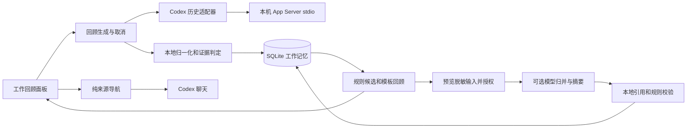
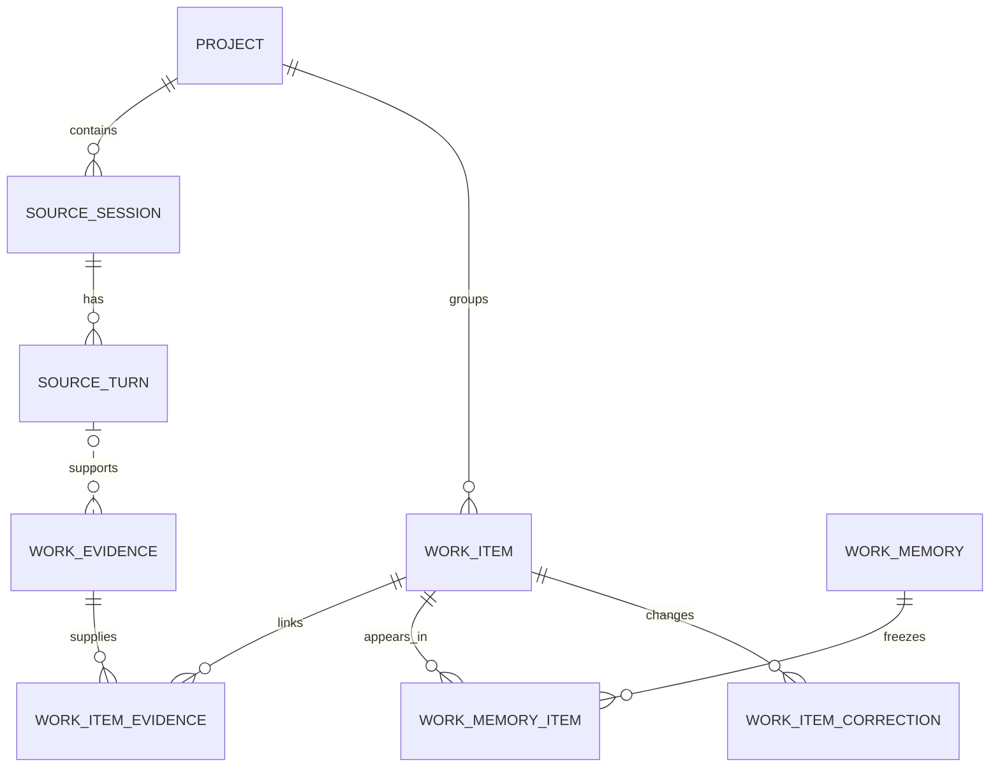

# Dynamic Pearl V2.3 · Work Memory 技术可行性与迭代规划

研究基线为 2026-11-19、Windows、Dynamic Pearl V2.2.2 工作区。本机安装包为 OpenAI.Codex `26.1111.2228.0`，同包中的 CLI 为 `0.169.0-alpha.11.1`。仓库当时无 `HEAD`，代码引用以本次读取的工作区文件为准。本文是开发规划。

## 1. 执行摘要

**建议立项。以「可追溯的工作回顾」交付 V2.3，采用独立的本机历史读取器、SQLite 工作记忆库、规则证据判定和按需授权的 AI 归并。** 用户选择项目和日期后，可以看见哪些工作有进展、依据在哪里、下一次从哪条聊天接着看。基础回顾完全离线，模型在脱敏和授权后提供归并候选和短摘要。

本机公开 App Server 已读到灵动珠项目的桌面聊天和两条 `codex exec` 记录，并拿到了活动回合的起始时间、已结束回合的起止时间、命令退出码和项目路径。样本足以验证读取路径和第一版信息价值。桌面全部历史的覆盖率、跨天与长会话、旧格式和归档内容仍需验收。独立进程与桌面连接给出的活动状态有差异，实时活动继续以现有桥接提供。

首版处理用户主动选择的本机 Codex 项目，支持今天、昨天、近 7 天、项目内多事项、跨聊天保守归并、人工拆合、证据展开和来源回跳。续接线索只提炼实际记录中的待确认事项。发布与验收接入、自动日报、其他数据源及单独的「继续上次工作」入口进入后续计划。首版可以显示从记录中提取的发布或验收声明及其待核实状态。

## 2. 现有项目能力盘点

| 位置 | 现有行为及 V2.3 接入点 |
| --- | --- |
| [`codex_activity.py:21`](../codex_activity.py#L21)、[`codex_activity.py:207`](../codex_activity.py#L207)、[项目 Hooks](../.codex/hooks.json) | `UserPromptSubmit`、`Stop`、`Interrupt` 读取工作目录、`session_id` 和 `turn_id`，通过 `thread:turn` 写入本机 `%LOCALAPPDATA%/DynamicBottle/codex-*.json`。Windows 文件锁与原子替换保护更新。最多保留近期 40 条及可能额外保留的一条挂住记录，保存项目简称与生命周期状态。可用作发现线索。其时间是桥接观察时间，`desktop` 是 Hook 写入标签，不能据此判断真实 Codex 来源。 |
| [`codex_activity.py:119`](../codex_activity.py#L119)、[`codex_activity.py:249`](../codex_activity.py#L249) | 活动视图每个聊天取最新轮，新结束短暂可见。CLI 路径运行 `codex exec --json`、每 3 秒心跳并从 `thread.started` 取聊天 ID，桥接记录使用本地随机任务键。CLI 心跳约 12 秒、Hook 一小时无有效更新后可能转为「未确认」。CLI 桥接键不能当作 App Server 回合 ID，`ended` 仅表示这次调用结束。 |
| [`app.py:408`](../app.py#L408)、[`app.py:471`](../app.py#L471)、[`codex_activity.py:148`](../codex_activity.py#L148) | `WeatherBottle.poll_activity` 正常可见时每 400ms 读取桥接，托盘逻辑降频。它维护待查看、挂住、过期和提示事件。同聊天下一轮可清除旧待查看状态，普通已查看状态在内存，挂住状态单独持久化。同一状态机继续驱动光珠与短舱。历史采集不进入该轮询。 |
| [`activity_panel.py:27`](../activity_panel.py#L27) | `CodexThreadNames` 使用 `shutil.which`、`QProcess`、行分帧及 `initialize`/`initialized`，按已知 ID 请求 `thread/read(includeTurns=false)`，仅显示 `name` 并短期内存缓存。现有协议握手及相关 ID 校验可参考。它的超时、断线清空和面板关闭即停针对标题请求，历史采集应有独立生命周期、限流、错误分型与可取消分页。 |
| [`app.py:494`](../app.py#L494)、[`app.py:543`](../app.py#L543) | `open_activity` 用 `QDesktopServices.openUrl` 打开本机 `codex://threads/{id}`，同时影响待查看、挂住和面板状态。建议抽取纯来源导航，实时入口继续在调用成功后处理其业务状态。工作回顾调用纯导航。 |
| [`activity_panel.py:362`](../activity_panel.py#L362)、[`activity_panel.py:499`](../activity_panel.py#L499)、[`quick_panel.py:20`](../quick_panel.py#L20) | 光珠的快捷入口是 `ActivityPanel` 的 `quick` 模式，`QuickPanel` 实际是经典天气瓶盖舱。前者已有 `dismiss_then`、屏幕边缘定位和玻璃过渡。`WeatherBottle.toggle_activity_panel` 在运行、有待看或专注时优先打开对应视图，新增入口需覆盖这些路径。 |
| [`glass_dialog.py:240`](../glass_dialog.py#L240)、[`pearl_style.py:162`](../pearl_style.py#L162)、[`typography.py:19`](../typography.py#L19) | 可复用面板定位、动画、按钮、日期选项、玻璃材质、主题及文字排版。`ambient_orb.py` 负责短时反馈编排，`activity_visual.py`、`renderer.py` 负责光珠、短舱和经典瓶体绘制。历史读取与绘制之间保持独立。 |
| [`app.py:66`](../app.py#L66)、[`app.py:1025`](../app.py#L1025)、[`reminders.py:233`](../reminders.py#L233)、[`focus.py:6`](../focus.py#L6)、[`workday.py:14`](../workday.py#L14) | `QSettings` 已保存天气、外观和时段等设置，提醒使用结构化设置，专注时钟在内存。天气有独立的 `QNetworkAccessManager`。接入回顾面板时需要处理拖动、托盘、专注和到期提醒的让位与恢复。 |

当前缺少历史发现及增量、稳定项目映射、工作事项与证据模型、回顾快照、纠错持久化和经授权的模型能力。V2.3 的正式集成集中在 `app.py`、`activity_panel.py` 及独立的 Work Memory 模块。现有活动范围开关对应实时 Hooks。工作回顾拥有独立的项目授权；开启全局活动不会授予历史读取权限。

## 3. Codex App Server 能力验证

### 3.1 验证方法与可复核结论

先用现有 Codex 桌面连接做有界元数据对照。普通、归档各读取两页，每页 2 条，两组各自无跨页重复；普通样本覆盖 3 个不同 `cwd`，归档样本覆盖 4 个。当前聊天通过同一连接读取到 `active` 和 `inProgress`，含起始时间、空结束时间。桌面连接的 `list_threads`/`read_thread` 属于 Codex 自身工具，灵动珠不依赖它们。

本机控制套接字连接失败（Windows `10050`）。经授权，使用本机同版本二进制临时启动 `app-server --listen stdio://`，在进程参数关闭 analytics；分别实测后子进程均以退出码 0 结束。测试只向标准输入发历史读取请求，`thread/list` 用本项目精确 `cwd` 和 `useStateDbOnly:true`，仅对本项目聊天读取回合和条目。留存的是聚合统计，无聊天正文、命令正文、具体聊天 ID 或输出摘录。另以 `generate-json-schema --experimental` 导出同版本协议到临时目录校验字段，实验性字段出现在 Schema 与稳定请求实测可用是两件事。公开协议说明见 [OpenAI · Codex App Server](https://learn.chatgpt.com/docs/app-server)。

| 能力 | 本机实测与边界 |
| --- | --- |
| `initialize` → `initialized` | 标准输入输出 JSONL 握手成功。测试历史方法无需 `experimentalApi`。二进制缺失、字段未知或历史模式不兼容时，应在适配层报告，应用仍可运行。 |
| `thread/list` | `cwd`、`sortKey:"updated_at"`、`sortDirection:"desc"`、`limit`、`cursor`、`useStateDbOnly` 可用。默认筛选只返 1 条本项目桌面聊天，`source:"vscode"`。显式 `sourceKinds:["cli","vscode","exec","appServer","unknown"]` 与 `modelProviders:[]` 返回 2+1 条，共有 2 条 `exec`，跨页无重复。该试验同时改变两个过滤器，不能单独量化 provider 的影响。`source` 描述记录来源；样本说明桌面聊天可能以 `vscode` 标记，`appServer` 不是桌面历史全集。 |
| `thread/read` | `includeTurns:false` 读取当前聊天和先前的 `exec`，返回 `id`、`sessionId`、`cwd`、`source`、`createdAt`、`updatedAt`、`historyMode`、`status`。本机契约还含 `projectId`、`name`、`originator`、`cliVersion`、`gitInfo`、`preview` 等；当前与旧样本的 `projectId` 均为空，一个样本没有名字。`preview` 可能含首条用户消息，应按正文处理。`gitInfo` 是创建时的可选元数据，不能据此推知后续提交或推送。 |
| 已结束与当前运行 | 两条先前的 `exec` 都能从独立进程读出回合，详细检查的一条有 `completed` 和起止时间。当前桌面聊天在独立进程为 `notLoaded`，所读回合当时为 `interrupted`、结束时间空；桌面现有连接当时报告 `active/inProgress`。传 `{}` 的 `thread/loaded/list` 在新进程返回空。因此它仅体现连接实例内加载情况，持久化回合视图亦可能落后或由恢复逻辑重建。独立历史进程的状态不可触发实时「结束/中断」通知。桌面进程关闭并重启后的覆盖尚待验证。 |
| `thread/turns/list` | 可按 `threadId`、`limit`、`sortDirection` 分页。实测 `itemsView:notLoaded/summary/full`。`summary` 样本含用户和助手文本，`full` 另有命令、工具等。`Turn.id/status/startedAt/completedAt/durationMs` 可读，时间或时长可能为空；本机 Schema 的回合时间是 Unix 秒。本项目抽样均只有一轮，多回合续页、跨天及随写入翻页的一致性尚未实测。 |
| `thread/items/list` | 按选定 `turnId` 限定范围，实测同一回合 4+4 条、跨页无重复，条目均附 `turnId`、`item`、`startedAtMs`、`completedAtMs`；8 条样本的毫秒时间均非空。观察到结构化 `commandExecution.exitCode` 和非空 `aggregatedOutput`，也观察到 `mcpToolCall`。输出可能缺失、截断或延迟落盘，任意 MCP 工具结果的业务可信度和完整性未验证。 |
| 归档与覆盖率 | `thread/list` 的 `archived:true` 请求成功，但本项目精确路径样本为空。桌面连接已翻到其他目录的归档元数据，公开 API 对非空归档的列表和按 ID 回读是 Phase 0 实验。普通与归档分别翻页。交互 CLI、`appServer` 来源、旧格式、非默认 provider、不同账户或 Codex 数据目录、项目工作树与子目录、临时和远程会话覆盖尚未知。 |
| 来源跳转 | Windows 已登记 `codex` 协议，本项目已有按聊天 ID 跳转的调用，官方支持本机聊天级深链。本轮未触发桌面切换，普通、CLI、归档的实际跳转分别验收。精确定位回合缺少已验证的 URL 契约，保留回合 ID、时间和标题供定位。 [OpenAI · Commands / Deep links](https://learn.chatgpt.com/docs/reference/commands#deep-links) |

### 3.2 官方契约与降级顺序

- `thread/list` 的默认来源是 `cli`、`vscode`，默认 provider 通常为已配置 provider。以明确的本机来源集合测试覆盖，`exec` 和 `appServer` 均纳入主任务候选；`unknown` 仅在能确认本机和项目归属时纳入。子任务只在未来有明确父子证据关系时引用，避免双计。`cwd` 是精确过滤，支持已授权的多个路径，普通与归档独立游标。`useStateDbOnly:true` 避开官方描述的 JSONL 扫描修复路径，但可能漏索引。用桌面对照定量评估，禁止自动切回会修复元数据的模式。 [OpenAI · List threads](https://learn.chatgpt.com/docs/app-server#list-threads-with-pagination-filters)
- 新历史优先 `thread/turns/list` 的轻量视图和 `thread/items/list` 的按轮分页。支持但取不到 items 的存储可试该轮 `itemsView:full`，且要限制响应字节。`thread/read(includeTurns:true)` 仅考虑作为已识别旧版、小而可控会话的兼容路径。无分页、体积未知或过大则只出活动与缺口提示。当前二进制的 Schema 也含 `thread/items/read`、`deferOutput`，此轮未测，首版无需依赖。游标保持原过滤条件，碰到重复锚点去重。 [OpenAI · Stored thread history](https://learn.chatgpt.com/docs/app-server#list-thread-turns)
- `path` 为不稳定实现信息。JSONL、`session_index.jsonl` 和 `state_5.sqlite` 在本机存在，本轮未读其内容。V2.3 不绑定其结构。未持久化的临时聊天、被删除的记录、压缩缺失或截断内容和从未被记录的外部动作，可显示覆盖缺口。归档、删除、压缩、恢复会话均不由采集器发起。 [OpenAI · Threads](https://learn.chatgpt.com/docs/app-server#threads)

### 3.3 日期和增量契约

`今天`、`昨天`、`近 7 天`使用用户本地时区的自然日，近 7 天含今天。以本次生成时刻冻结时区和 `asOf`，计算 UTC 半开区间 `[start,end)`，今天上界额外截到 `asOf`。存储统一用 UTC 毫秒，按字段类型转换秒与毫秒。时区变更生成新范围，重现老快照仍用它自己的时区。用本地日历构造边界以兼容夏令时。

1. 会话 `updatedAt` 用于发现候选与增量排序，`createdAt` 用于会话元数据，均不能代替回合证据日期。按项目别名和归档两路从顶部扫描，重扫一段重叠窗口。只有 Phase 0 证明 `updatedAt` 能稳定覆盖新增及晚落盘回合后，才启用按高水位提前停止。水位至少保留 48 小时回扫并触及已知进行中/未读全的聊天，48 小时是待实测调优的初值。游标仅服务本次读取，失效后从顶部重新开始。预算耗尽需显示部分结果，不越过失败页提交水位。
2. 条目在其有可靠时间的事件日显示，例如昨晚开始的测试今天结束，以命令结束事件作为今天的执行结果。回合开始与结束分别记事件，跨午夜时可在两天都出现同一事项，但同一事件只算一次、区间内同一工作事项只计一个。起始于区间外的回合只要结束或条目落在区间内也要纳入；长回合翻页早停需有顺序、最大跨度与无未决回合的依据，否则按预算读并标部分。回合与条目均无可信时间时进入「时间待确认」，不计入精确日统计；仅有回合区间而无条目时间且跨天时，证据展示日期范围，避免把成功绑定到某一天。
3. 针对旧线程、新结束回合、归档迁移、压缩或撤回后的数据，按回合/条目 ID 与来源修订指纹幂等更新。成功完成范围核对才更新可见性。一次空页、失败或项目过滤变化不能推导删除。实时桥接只有 ID 可对上的 Hook 记录才补观察时间，并明确标记为桥接估计。稳定会话/回合 ID 优先，缺失 ID 的事件只生成局部不可合并的观察项。

## 4. 推荐产品方案

- **上班找上下文。** 打开「昨天」，查看分项目的事项、最后一条可靠进展和待核实线索，点回来源接着读。
- **下班前回顾。** 打开「今天」，确认各事项实际做过的工作，用户可以纠正归并或标记自己确认过的事实。
- **周会前检查。** 打开「近 7 天」，同一事项按时间线出现多个事件，概览按事项去重。未完整读取的项目显示范围提示，待核实状态单独呈现。

首轮交互是「选择项目与日期 → 生成 → 浏览概览 → 展开事项 → 查看证据或打开 Codex」。同项目的多需求保持独立；跨项目只能人工建立关联，首版不跨项目自动合并。首页展示最近生成的同范围快照和生成时间，手动刷新后才读取历史。下一步线索来自明确的阻塞、未完成检查或当时留下的计划，附来源和观察日期。若近期证据已解决则隐藏当前线索，保留原时间线。没有合格线索时可省略整块。

## 5. 推荐技术架构



建议新增 `work_memory/source_codex.py` 管理历史协议、版本与字段解码，`work_memory/review.py` 处理日期、候选、证据和快照，`work_memory/store.py` 管理 SQLite，Phase 3 再加 `work_memory/summary.py`，Phase 4 独立 `work_memory_panel.py`。首期可在 `review.py` 内维持规则与归并边界，复杂度确实增长再拆。来源适配契约约束 `list_sessions(scope,cursor)`、`list_turns(session,cursor)`、`list_entries(turn,cursor)` 和 `make_locator(ref)`，分页返回 `next_cursor`、`coverage`、`warnings`。存储和视图使用通用 `source_namespace`、工作动作和来源引用。后续 CI 可提供一条执行记录作为事件，无需伪造聊天回合。

**存储决策。** 使用 Python 标准库 `sqlite3`，放在 `%LOCALAPPDATA%/DynamicBottle/work-memory.sqlite3`。SQL 事务、唯一键、外键及索引适合区间检索、多对多关系和原子纠错；现有 QSettings 继续保存轻量 UI 偏好，活动 JSON 继续承担短生命周期热路径。用 `PRAGMA user_version` 做事务迁移，开启外键，单工作线程写入，短事务、限时重试；初期可用默认回滚日志，确有多读者阻塞再评估 WAL。关键索引是 `(project_id, updated_at)`、`(session_key, started_at)` 和 `(project_id, occurred_at)`。SQLite 侧只落最小结构化字段和选定的短证据摘录，不持久化完整回合、命令输出、任意工具参数或模型请求正文。

**执行与恢复。** GUI 线程只处理状态和分页渲染，后台任务拥有 stdio 子进程及 DB 连接。单个生成任务对相同范围合并请求，取消或范围改变用任务代号隔离迟到回调。独立进程按用户生成动作启动，限定并发、页数、响应字节和截止时间，分开处理 stderr，忽略未知通知，拒绝所有反向请求。建议初始页大小为会话 25、回合 20、条目 25，总字节预算按 Phase 0 结果确定。单次请求超时可带退避重试一次，失效游标最多重新从头扫一次；退出时收束本任务子进程，不操作桌面进程。会话/回合数据可小批幂等提交，快照及其覆盖记录整批发布；取消、磁盘满、崩溃保留上次已发布结果。界面区分「成功但无活动」「部分数据」「权限或项目未选」「来源不可用」「模型不可用」；旧快照标明更新时间，不冒充当前生成结果。

**隐私。** 项目选择器来自用户明确选的目录或本地已有工作区路径，展示和授权均以项目为单位。只在生成时发现会话，并在加载回合前再次检查解析后的项目和本机身份。不支持服务端范围过滤的版本禁止宽范围内容回退；未知项目不自动纳入。模型默认关闭，批准的请求展示模型及接收方、选定项目、拟发送字段与脱敏片段、预算及保留政策入口。剔除代码块、命令与输出原文、凭据、内部地址、文件路径及大段正文；脱敏失败时该片段走离线模板。授权变化立即停止新请求。凭据用 Windows 凭据存储或用户已配置的安全引用。模型无工具和执行权限。历史聊天和命令文本始终是数据，不跨过执行、URL、文件和网络权限边界。应用诊断只保留计数、错误类别和版本。

**缓存与删除。** 建议本地快照、普通证据默认 90 天可调整，显式人工纠错保留至用户删除或项目清除。期限是待验证的产品默认值。界面可排除项目、删除项目记忆或清空全部，说明删除仅作用于灵动珠。停止相关生成任务后事务删除证据、快照、缓存、纠错及断点；保留用于阻止自动纳入的排除偏好。清除后再次生成才会按用户选择导入；如需对单个来源长期排除，保存其最小标识。清理 SQLite 辅助文件需与关闭连接、checkpoint 或重建数据库协调，不能承诺删除操作可抹去系统备份。回顾仅供个人主动查看，缺少员工监控和自动共享链路。

## 6. 数据模型、事项归并与摘要

| 对象 | 职责与关键字段 |
| --- | --- |
| `Project` | 本地生成的稳定 `project_id`、简称、已授权路径和别名、可选上游项目 ID 与 Git 规范化标识、排除状态。解析 Windows 路径、分隔符、大小写及重解析点，Git 根和工作树映射仅在授权范围内使用；重命名与工作树扩展由用户确认绑定。同名目录和同一 remote 的不同副本仍有独立身份，除非显式关联。 |
| `SourceSession` | 主键 `(source_namespace, thread_id)`。记录本机来源实例、项目、来源分类、`session_id`、生命周期元数据、归档状态、可用性及观察时间。`source_namespace` 区分来源类型和已授权的数据根，`session_id` 保留谱系信息；fork 是新聊天身份。 |
| `SourceTurn` | 主键 `(session_key, turn_id)`。记录状态、起止时间、时间来源/精度、最近成功读到的历史模式与修订指纹。回答文本在生成期内存短暂处理。常规条目无需另建原文表，有用条目归为证据。 |
| `WorkEvidence` | 稳定 ID、来源对象/条目键、类型、事件及观察时间、作用范围、结果和最小事实字段、摘录或摘要校验指纹、可见性与修订。作用范围可包含项目、工作树、Git SHA 或脏状态、测试集、目标环境等。采用 `(来源定位键, 断言类型, 作用范围, 修订)` 防重复，也允许同一证据指向多个事项。回合/条目键和类型确定重复采集，指纹仅用于检测修订。 |
| `WorkItem` | 本地稳定 `work_item_id`、项目、标题、可选 issue/PR 标识、创建时间、最后活动和归并修订。通过 `WorkItemEvidence` 与证据关联，记录匹配规则、置信度与确认者；一个回合涉及多个事项时按条目或语义片段单独建链。各里程碑视图从当前证据投影。 |
| `WorkMemory` / `WorkMemoryItem` | 按 `range,start,end,timezone,projects,as_of,source_revision,rule_version` 生成快照；关联该版本展示的事项/证据、短文、覆盖标志与摘要模式。相同输入与规则版本重复生成复用快照，生成授权版摘要时用独立修订，不复制源记录。`FollowUpHint` 首版存为事项快照里的小结构，含 `text, kind, evidence_ids, observed_at`；形成跨快照续接查询需求后再独立建表。 |
| `WorkItemCorrection` | 用户确认、拆分、合并、禁止合并、项目别名动作的变更记录，含作用目标、作用范围、修改前后关系、时间与可撤销标识。合并保留别名指向，拆分将指定证据迁出并保留用户置顶的标题；撤销回放对应关系修订。用户确认通过独立证据记录签名来源为本机用户。 |



生成重跑按稳定键更新、复用已验证证据和人工纠错。某条证据被撤回、确认缺失或可见范围改变时，旧快照保留当时的展示语义并标「来源不可用／已变化」，不将该证据用于新确认状态。项目删除同时清除旧快照中的相应片段。外部引用不可访问时保留最小定位信息和最后观察时间，用可访问性标志控制继续汇总。人工裁决在重新生成中优先，并绑定到选定证据锚点，防止拆分过的事项被模型合回。

### 6.1 先确定候选，再判断是否属于同一事项

1. 在已授权的同一项目中切分工作片段。优先用明确的用户目标、工具执行关联和已知 issue/PR/提交，标题只用于展示与候选召回。同一聊天里的独立需求可以从下一次明确的用户目标、不同条目或分支上下文分开。
2. 高置信自动合并仅限用户既有确认，或同一项目的明确、带命名空间的工作标识且不存在相反证据，例如两个来源明确围绕同一个 issue。选择事项时逐条验证新增片段与组内事实是否相容，避免 A 像 B、B 像 C 就把 A 与 C 全合并。同一分支、文件、项目或相似标题仅提高召回。不同的强标识、独立目标或用户设置的禁止合并直接阻断自动合并。
3. 中置信标为「可能是同一事项」，以显式接续旧聊天、相似目标、有重叠文件或近期时间窗等互补线索给出理由。模型可排序与建议，用户在详情侧并排查看证据后确认合并或保持独立。低置信保留独立事项。置信度表示关联可靠性，证据等级表示断言可靠性，分别存储。防止误拆靠带出处的候选提示和人工合并，防止误合靠限制自动操作、禁止链式聚类及一键拆分/撤销。
4. 用「上午排查订单重复」「下午同 issue 修复」「晚上同 issue 自测复查」形成工作线索链。相同项目的日报权限改动保持独立；若前两个记录仅标题相似，则显示合并候选。对标注的中文真实样本记录误合和漏合，先以精确率约束自动合并覆盖，再增加召回。

### 6.2 模型决策

| 方案 | V2.3 取舍 |
| --- | --- |
| A · 规则和模板 | Phase 1 即可交付，长期作为默认模式与模型失败时的降级。通过日期、真实事件、标题和明确标识形成按项目列表，弱语义下以保守拆分和人工合并承担局限。 |
| B · 本地筛选与授权 AI | 推荐作为 V2.3 的可选增强。规则控制数据范围、等级和事实，模型只返回候选关系与摘要提纲。使用用户明确配置的模型与凭据，独立于 Codex CLI 登录，授权状态可按项目和接收方撤回。 |
| C · 纯本地模型 | 技术可行性取决于量化模型与运行时。可用数十亿参数的 INT4 模型做后续实验，光模型权重就可能占数 GB 级磁盘及内存预算的一部分，另需算上 KV 缓存和运行开销。普通办公机的 CPU/GPU、中文跨会话判别、首 token 延迟和下载维护成本差别较大。本机未做模型基准。首版不随安装包部署模型。后续以 8/16GB Windows 样机测内存峰值、完成延迟和中文误合率再立项。 [ONNX Runtime · Generate API](https://onnxruntime.ai/docs/genai/) |

每项目把可疑归并的片段和证据按候选组小批处理。初始预算可设每批 4k 输入/600 输出 tokens、每次最多 20k 输入 tokens，可配置且测试后调整；超额先用时间、强标识和覆盖面排序，余项保留离线结果并提示增强范围。缓存键含脱敏输入摘要、范围、项目、模型、提示词与归并策略版本，不复用权限已撤回的数据。记录 token 用量，估算费用时使用当前所选模型的价格，文档不承诺固定成本或延迟。

建议结构为 `merge_suggestions[{candidate_ids,evidence_ids,reason}]`、`summary_lines[{item_id,fact_ids,text}]`、`follow_up_hints[{item_id,source_fact_ids,text}]`。模型只见本批匿名 ID，结构输出再经本地 Schema、外键、项目/日期范围、候选约束、来源语义和已撤回检查。已确认状态行由规则模板渲染，模型文字不能创建或提升状态；无法支持的内容丢弃。对计划类语句，只有对应的明确阻塞或待办事实才允许产生续接线索，其余用原有模板。拒绝、截断、无效结构或模型不可用立即返回规则回顾；网络超时和 429 可按授权预算退避重试一次，避免重复出账和重复发布。结构约束校验的是形状，事实校验由应用承担。 [OpenAI · Structured model outputs](https://developers.openai.com/api/docs/guides/structured-outputs)

## 7. 状态与证据体系

证据映射由本地代码按事件类型、结果和对象计算。为每个里程碑输出 `(milestone, outcome, evidence_grade, subject_scope, as_of, evidence_ids)`。`outcome` 可为成功、失败、进行中、冲突或未知，同一事项可以同时「有修改记录」「测试失败」「发布未核实」。无全局完成布尔值。

| 等级 | 条件与呈现 |
| --- | --- |
| `Verified` · 有记录 | 可信、可归属的结构化记录满足该断言所需条件。证据允许验证成功、失败或其他真实结果。显示「测试通过 · 有执行记录」等具体结果。 |
| `UserConfirmed` · 用户确认 | 明确记录谁、何时确认哪项、针对哪个版本或环境，独立标记。可以向用户显示「已验收 · 你确认」，只在其主张范围内生效。自动验证与人工确认各保留，矛盾时显示两种观察。 |
| `Reported` · 会话报告 | 有明确记录声称发生，缺少对应的执行或系统证据。通常来自 Codex 或外部文本，显示「Codex 报告测试已通过 · 待核实」。历史聊天中的普通声明不会自动转成用户确认。 |
| `Inferred` · 线索 | 按上下文推测，例如写过测试文件或提到需等待反馈。表现为「可能需要核实」，只用于后续线索。 |
| `Unknown` · 待核实 | 没有足够证据、来源不可读或对象归属不明。沉默不会变成失败或完成。 |

| 要展示的状态 | 可用证据与限制 |
| --- | --- |
| Codex 回合结束 | `SourceTurn.status` 与可用的 `completedAt`，保留 `completed`、`interrupted`、`failed` 的差异。桥接 `Stop` 可证明收到生命周期事件，独立进程的 `notLoaded` 仅表示其载入状态。 |
| 有代码变更 / 实现完成 | 成功 `fileChange` 及具体文件范围可以确认当时应用了改动，有版本归属的 diff/提交能进一步说明具体变更。需求已完整实现需明确验收标准与证据或用户确认。恢复文件、后续修改和工作树隔离都可能改变当前状态。 |
| 本地测试通过 | 受支持测试命令结构、成功退出码、实际执行的测试数与结果，能绑定工作树、版本或时间及测试范围。零测试、跳过、不识别的脚本、复合命令掩盖退出码、关键输出截断时仅展示可确定事实，例如「命令退出 0，测试范围待核实」。单测通过只证明该次该范围。历史测试不自动适用于后续变更。 |
| Git Commit 已创建 | 成功写入的可信 Git 事件或可独立核对的仓库对象与 SHA、相关事项/变更；创建命令退出 0 或聊天出现 SHA 本身不足以证明归属。记录本地 commit 可存在与后来重写/移除。 |
| Git Push 已成功 | 有可信推送报告或远端引用/服务事件，能核实 remote、目标 ref 和 SHA 以及时间；本地 `origin/*` 缓存不足以代表当前远端。单独记录该版本曾被推送，后续强推不抹除历史。 |
| Beta 环境部署成功 | CI/CD 或发布系统成功部署记录，绑定 Beta 环境、构建或 SHA、时间；仅通过 CI、推送或发布工单文字不能确认部署。回滚后当前部署使用环境的最新可信观察。 |
| 测试人员验收通过 | 可信测试/审批记录，或用户针对对应构建、环境和范围的显式确认。自动化测试、部署成功和未收到反馈均无法支撑验收通过。 |

首版自动判定从回合生命周期以及少数可完整识别的本地测试开始，若 Phase 0 未验证到可靠的对应工具项与结果，则上线该里程碑的「已报告／待核实」展示。Git、发布及验收缺少来源时按声明显示，完整的自动结论留给后续适配。命令输出属于不可信文本，只有经过受控工具类别和解析规则验证、能绑定正确对象时才参与证据裁决。无法识别时折回到「命令返回码」事实。

冲突处理先比较对象、版本、环境、测试集和事件时间，再比较信任度。对同一对象，后续可信失败替换该对象当前投影，旧的成功留在时间线；同版本证据确实相互矛盾且顺序不明时显示「记录冲突」。较新的自然语言声明不能覆盖已有结构化事实，可作为「最新声明待核实」并列。不同对象的成功和失败分别呈现。删除或截断使证据不足时当前状态回退为待核实。MVP 统计可核对的活动和不同工作事项数，缺数据时附范围，不计算业务完成率。未来需要完成率时，先定义业务里程碑、可判定且去重的分母，再分别统计核实、人工确认和未知。

## 8. 交互设计与未来演进

光珠空闲时从 `ActivityPanel.quick` 添加「工作回顾」入口，经 `dismiss_then` 打开独立玻璃面板。活动/专注优先模式可以在现有面板内通过一个轻量回顾入口到达，保持点光珠仍打开当前活动或计时。经典瓶盖舱可复用 `QuickPanel.run` 提供同入口。独立面板复用 `PopupAnimation`、`popup_geometry`、`GlassChip`、主题和字阶。面板上限建议 360–420 逻辑像素宽，顶部和底部固定，中间滚动并按屏幕工作区裁定高度，先绘玻璃轮廓再显示内容。尺寸是待验证设计值。

| 层级 | 首屏内容与动作 |
| --- | --- |
| 顶部 | 「工作回顾」、关闭、今天/昨天/近 7 天、已选项目、生成或刷新。首次选择可同时排除项目。 |
| 概览 | 项目组默认 1–2 条进展，附生成时间和缺口提示。项目组展开看到同项目的独立事项，同一事项按最新有证据事件排序。 |
| 事项 | 标题、时间线、状态证据和下一步线索。归并候选在相关项旁展开，可按证据拆分/合并和撤销。手动确认写明对象和范围。 |
| 证据 | 原始来源类型、项目、时间、简短片段、回合定位和「打开 Codex」。失败显示可复制的本机聊天/回合 ID、标题和时间。文本用 PlainText，URL 按白名单和 ID 校验生成。 |

加载可取消、可返回上一次快照，取消时不等待 UI 主线程。Esc、外部点击、拖动、托盘隐藏和多屏换边复用既有交互约定；减少动态效果仅做短过渡或直接呈现。提醒或专注到点时优先提供原提醒入口，面板让位并保留回顾浏览位置，关闭后可再次打开。避免将回顾窗口登记为长时间模态输入，从而无限推迟 `show_due_notice()`。活动 polling、专注计时和提醒在生成期间继续运行，工作回顾成功不触发光珠常驻状态。

**继续上次工作。** 从最近 `WorkItem` 按有效 `WorkEvidence` 恢复上次进度和 `FollowUpHint`，可优先打开末次有效来源聊天。用户决定继续哪个事项和是否输入新消息。来源不可用显示原定位与最后可证实进度。

**Beta 交接。** 增加 Git、CI/CD、测试审批来源适配器，以 Git SHA、构建 ID、环境和验收主体归属 `WorkEvidence`。同一个 `WorkItem` 可展示实现、测试、提交、推送、发布、待反馈和验收的连续记录。可按环境重放并识别回滚，旧快照可显示当时部署版本。

**自动回顾。** 后续独立开关选择项目和时间，触发一次静默增量任务。成功可在空闲时短舱轻提示一次后回归光珠，主动面板、专注、到期提醒和 Codex 活动优先。统计保留按自然日和 `asOf`，下班时间只是提醒触发选择。晚间新增活动在下次刷新或补扫时进入回顾。

## 9. 分阶段开发与验收

估算单位为单人研发人日，包含阶段内测试、一次评审和修正。区间按当前 PySide6/CLI 可复用程度与未知兼容分支估算，等待样本、权限或评审的日历时间另计。以下性能和准确度是验收建议，需在 Phase 0 建立基线后确认。

| 阶段 | 必做工作、模块及输入输出 | 风险、测试、退出条件 | 前置与工作量 |
| --- | --- | --- | --- |
| **0 · 覆盖与兼容** | 参考 `CodexThreadNames` 握手与 Hook 来源键。新增一次性只读探针和匿名覆盖表。输入用户选定的历史样本与手工标注，输出 API 能力表、日期精度、缺口、耗时、跳转结果和兼容记录。 | 真样本核对桌面列表、普通与归档、多个项目、旧格式、长会话、交互 CLI、`exec`、跨天、关闭后读回、压缩与晚到。可用样本内达到下节门槛、缺口可检测且明确聚焦支持范围，才进入公开历史采集开发。 | 需当前版本与用户选定样本。**2–4 人日**，包含样本对照和可复跑探针。 |
| **1 · 基础活动** | 新增 `source_codex.py`、`store.py`、`review.py` 和无界面入口。输入日期、项目与页数据，输出 SQLite 归一化记录、覆盖提示和按项目模板回顾。查用已有桥接的 ID 类型、展示名和纯定位规则。 | 测秒/毫秒、空时间、午夜、夏令时、回合跨天、分页重叠、超时、取消、并发请求、晚到、进程关闭、重试和重跑。固定夹具中日期、项目及已知 ID 全匹配，空与部分准确区分，重复导入计数不增加，隔离项目无越权读取。 | Phase 0 支持矩阵成立。**4–7 人日**，协议兼容、增量与 SQLite 各需独立测试。 |
| **2 · 事项和证据** | 在 `review.py` 和 `store.py` 建关联、里程碑、人工拆合、确认和续接线索；先由基础入口验证操作。输入规范化活动与证据，输出状态投影、事项及修订。 | 用同项目不同需求、同聊天多个事项、三段同 issue、跨天、测试 0 项、复合命令、冲突、撤回和归并重跑套件。强规则所有回归夹具正确；人工标注样本试验以自动归并精确率 ≥95% 为启用参考，并要求跨项目和明确强冲突自动合并为 0。样本不足时仅开放建议与用户确认。错误自动标记发布或验收数量为 0。 | Phase 1。**4–7 人日**，主要工作为证据语义、纠错事务及标注回归。 |
| **3 · 授权 AI 回顾** | 新增 `summary.py`、项目及接收方授权与发送预览。输入有范围的脱敏片段及候选 ID，输出经过校验的简短摘要、候选关系、线索及缓存；沿用规则投影。 | 用 mock 模型做拒绝、截断、429、伪造 ID、提示注入、凭据和跨项目数据测试，另对用户允许发送的中文测试集人工核对。未经授权的外发请求为 0；渲染的状态与线索均可回溯，任何无效状态无法提升；故障会回到统一模板。度量候选被接受比例和人均纠正次数。 | Phase 2、独立模型授权与脱敏通过。**3–6 人日**，涵盖接入、校验、缓存和中文效果抽查。AI 未过线时 Phase 4 可先交付规则版本。 |
| **4 · 灵动珠集成** | 新增 `work_memory_panel.py`。在 `app.py`、`activity_panel.py` 接入入口、纯导航、窗口仲裁和取消；经典瓶盖快捷入口按同一设计集成。输入服务的快照和错误状态，输出可展开、有证据的轻量回顾。 | 实机测浅深色、100/150/200% DPI、四角与多屏、减少动效、Esc、拖动、收托盘、来源回跳、专注与到点提醒。空闲新增历史进程及历史定时器为 0，缓存首屏目标 ≤200ms，生成时应用交互可响应，Profiling 中历史工作不占用 GUI 线程。回跳不改待查看或挂住状态，链接失败有复制兜底。 | 可在 Phase 2 接好规则版后并行推进，Phase 3 挂可选增强。**4–7 人日**，计入面板、生命周期协调与桌面回归。 |
| **Future · 续接、交接和自动回顾** | 续接服务复用 `WorkItem`/`WorkEvidence`，Beta 交接增加外部证据适配器，自动回顾复用原生成任务。输入可信构建/部署/验收记录与用户配置，输出续接入口、版本化交接和可选单次提示。 | 模拟多 SHA、回滚、审批冲突、撤销授权、休眠与晚间续做；自动提示只在合适时机出现一次且回归光珠。继续工作打开原来源，用户主动发送消息。 | V2.3 实际使用结果、相应服务数据权限和接口。续接 **2–4 人日**；自动回顾 **2–4 人日**；交接每个来源初估 **3–6 人日**，权限和身份匹配是主要变数。 |

规则版交付估算为 **14–25 人日**（Phase 0、1、2、4），包含可选 AI 增强约 **17–31 人日**。为防止先重做 UI，Phase 1 无界面原型先经真实使用验收，面板工作从明确的服务和快照契约开始。

[Phase 1 原型和验证报告](dynamic-pearl-v2.3-phase-1.md) 已记录三个日期范围、两项目对照、缓存操作和仍待验收的兼容范围。

[Phase 2 事项与证据](dynamic-pearl-v2.3-phase-2.md) 已记录归并规则、人工纠正、证据等级和本机验证。

[Phase 3 可选 AI 回顾](dynamic-pearl-v2.3-phase-3.md) 已记录请求预览、逐项目授权、证据校验、缓存及故障降级。真实供应商调用仍待明确授权。

[Phase 4 桌角工作回顾](dynamic-pearl-v2.3-phase-4.md) 已记录本机面板入口、查询与纠正操作、缓存以及交互自测边界。

[WM-09 规则版本机验收](dynamic-pearl-v2.3-wm-09.md) 已记录缓存范围复核、归档覆盖提示、Windows 来源交接和双屏布局验证。

### Phase 0 余下的准入实验

本机两项目验证已产生 [Phase 0 报告及复跑方式](dynamic-pearl-v2.3-phase-0.md)。普通本机历史可进入 Phase 1 内部原型，公开支持范围仍按下表逐项验收。

建议用户指定至少 2 个项目、约 12–20 条可对照聊天。用桌面侧用户可见的明确样本作为覆盖分母，区分持久化、本机、已授权的预期样本与临时、远程等首版界外样本。输出按来源、归档、旧格式、路径类型分桶的分子、分母和失败原因，无法取样的桶保持未验证。

| 实验 | 成功后 | 失败后的产品决策 |
| --- | --- | --- |
| **公开接口覆盖。** 两项目普通及至少一条既有归档，包含 Desktop、交互 CLI、`exec`，尽可能补 `appServer` 或旧模式样本；对照项目目录、子目录、工作树与 provider；在桌面退出/重开前后对照持久化会话。目标为已纳入样本发现率 ≥95%，关键场景覆盖且明确每个缺口。 | 固定已验证来源集、过滤器与兼容矩阵，范围内标明已验证支持。 | 优先修正 authorized cwd 别名、source/provider 过滤。索引差异持续存在时缩窄支持范围，保留手工选择已知 ID（仍需核验项目）或只展示桥接活动线索。不稳定时暂停完整历史回顾承诺。归档缺口单独标示。 |
| **时间与分页。** 选真实跨天多轮、跨午夜单轮、长聊天和至少一组含命令的记录。用小 page size 强制遍历；并发新增、归档或撤回时重扫。缺样本可先用匿名夹具验证算法，真实仍标未知。 | 人工抽查日期归属全部吻合，分页重跑稳定后启用增量提前停止。以 7 天、2 项目、50 个回合的试验规模测 P95、响应字节数和峰值内存，设定实际预算。 | 禁止基于 `updatedAt` 或第一页回合做范围结论，以有时间的有限样本回顾，显示「部分读取」和「日期待核实」。必要时仅提供活动列表。 |
| **证据与回跳。** 手工选择同项目有测试、失败和普通命令的条目，对比退出码、测试范围、执行时间和版本；验证普通/归档/CLI `codex://` 打开正确聊天，以及无可用回合锚点场景。 | 启用能准确识别的测试事件类型，并通过来源跳转验收。 | 测试继续显示报告或待核实。始终保留最小定位信息。普通聊天回跳大面积失败时推迟「可追溯回顾」的 UI 交付。 |
| **历史缺损与协议兼容。** 对照客户端当前版本和一档计划支持旧版，覆盖未知字段、空时间、不支持 item 分页、压缩/截断、长结果和进程中止。 | 明确定义完整、部分、缺失、无活动，按能力选择读取模式。 | 限制支持版本或输出有限的元数据。内部 JSONL 读取只作为独立后续评估，需另验证格式、并发、数据范围和维护成本。 |

## 10. 风险与工程控制

| 风险 | 可验证的处理 |
| --- | --- |
| 1 · 本机历史不完整 | 显示已选择的项目、已处理来源和普通/归档覆盖，给 `coverage` 记录计数与原因。默认来源与显式来源独立对照，空列表与失败区分。 |
| 2 · 标题信息不足 | 标题仅用于候选和显示。以用户目标、明确标识、回合/条目证据支撑概览实体，缺内容时保留原活动。 |
| 3 · 同事项误拆 | 在同项目按强标识聚合，近窗口为无标识片段提供候选与理由，持久化用户合并。 |
| 4 · 不同事项误合 | 冲突硬阻断、校验整个候选组、禁止一键无审核应用 AI 结果；以困难负例、用户禁止合并及撤销做回归。 |
| 5 · 跨天统计偏差 | 归一化时间单位和时区；展示事件日期、可用精度与区间。同事项可跨日展开，按唯一 ID 去重，未知日期另列。 |
| 6 · AI 虚构完成 | 所有已确认状态只由本地证据规则和用户确认渲染。模型结构及引用双检，模板接管失败或无效输出。 |
| 7 · 测试和发布证据不足 | 命令退出码独立呈现，缺测试范围、SHA 或环境则仅陈述确认到的事件。Beta/验收仅在后续可信来源或显式用户确认后升格。 |
| 8 · 项目路径、会话 ID 变化 | 用户可管理路径别名，分离项目身份和目录。fork 与原会话保留不同 ID；归档尽量沿用原 ID；无法定位只标来源失效。 |
| 9 · 缓存滞后或实时误判 | 持久化 `as_of`、重扫重叠窗、重新拉取未决聊天和失败页。活动桥接专用的 `running` 等状态独立处理，避免历史投影覆盖实时。 |
| 10 · 历史规模增长 | 先会话后回合、内容按需分页；限制并发、预算、期限与快照保留，查询用索引；支持取消和续读。压测大输出和错误游标。 |
| 11 · 云端敏感数据 | 项目及接收方授权、脱敏预览、字段白名单、按预算发送；秘密检测或文件范围校验失败时局部降级，日志不落正文。 |
| 12 · 破坏桌面轻量体验 | 仅在主动面板生成、独立后台执行。基线回归显示/托盘 CPU、计时、提醒、DPI 和动画，不新增常驻状态。 |
| 13 · 未来新来源引发重构 | 使用来源命名空间与通用证据对象，来源 adapter 自己知道定位方式；以匿名 CI 单条事件夹具验证可接入现有状态投影。 |
| 14 · 会话恶意或误导性指令 | 把所有历史片段视为不可信纯文本，禁止执行原命令、打开来自内容的 URL 或将其作为系统提示词。模型无工具，输出 ID 绑定本地白名单。 |
| 15 · 重生成重复或引用失效 | 证据幂等键、快照修订与一次性发布，合并保留稳定别名，纠错持久化。回跳失效及缺损按来源可见性标注。 |

## 11. 最小可行原型

在 Phase 0 通过后，首先交付一个可选日期与项目的本地只读命令行原型。使用已验证的 stdio 握手、`thread/list`、`thread/turns/list` 及必要的 `thread/items/list`。只需进程内存或临时测试库，输出本地 Markdown/JSON 项目摘要、证据定位与覆盖元数据。先输出今天、昨天与近 7 天，同一项目中按明确 issue 归并，未知归属保留独立。若没有样本能确认测试结果，展示「执行过命令」和「测试报告待核实」。原型无模型、无新面板，需要时通过来源地址人工对照。

验证可用性的最小对照任务是「找出昨天两个项目的三条重要进展、定位一件未收尾事项并回到对应聊天」。由用户用桌面历史和原型各做一次，记录查对耗时、错误状态、缺项和需要人工合并的次数。建议以日期归属及重要来源均可核对、无虚构完成、两次生成结果无重复为硬门槛；若使用原型能明显减少反复搜索聊天，再投入统计、语义摘要和 UI。若覆盖准确但缺少事项线索，先优化规则和人工纠错。若日期和证据不可信，回 Phase 0 缩窄范围或修复来源适配。

用于复核本轮发现的最小请求序列如下。先用本机版本的 `initialize` 和 `initialized` 建连。`CWD`、`THREAD_ID`、`TURN_ID` 与 `CURSOR` 由用户授权范围及前次响应提供。真实请求仅替换占位符，打印字段、计数与可用性。

```jsonl
{"id":1,"method":"thread/list","params":{"cwd":"CWD","limit":2,"sortKey":"updated_at","sortDirection":"desc","useStateDbOnly":true,"sourceKinds":["cli","vscode","exec","appServer","unknown"],"modelProviders":[]}}
{"id":2,"method":"thread/read","params":{"threadId":"THREAD_ID","includeTurns":false}}
{"id":3,"method":"thread/turns/list","params":{"threadId":"THREAD_ID","limit":1,"sortDirection":"desc","itemsView":"notLoaded"}}
{"id":4,"method":"thread/items/list","params":{"threadId":"THREAD_ID","turnId":"TURN_ID","limit":4,"sortDirection":"desc"}}
{"id":5,"method":"thread/items/list","params":{"threadId":"THREAD_ID","turnId":"TURN_ID","limit":4,"sortDirection":"desc","cursor":"CURSOR"}}
```

列表负对照用相同请求去掉显式来源和 provider，归档对照从头请求 `archived:true`。使用历史专用进程，不发送新回合或变更请求。`includeTurns:false` 的空 `turns` 属于元数据视图。测试日志应只保留已验证与未验证项、样本量和差异。

## 12. 下一轮 Codex 实施任务清单

| ID | 优先级 | 可交接任务与交付物 | 依赖 |
| --- | --- | --- | --- |
| WM-01 | P0 | 完成 §9 的用户指定样本和兼容探针，交付按来源、日期、归档、旧模式、深链分桶的覆盖表与支持范围决策。 | 用户指定样本范围 |
| WM-02 | P0 | 实现可取消的 App Server 只读源适配器。依据本机 Schema 做时间字段、状态、分页和错误解码，明确未知字段、大小限制与兼容降级。 | WM-01 |
| WM-03 | P0 | 搭建日期/项目范围、模板原型与可复放的匿名夹具。对照真实使用任务，产出活动列表与证据定位。 | WM-02 |
| WM-04 | P0 | 实现 SQLite 归一化、项目映射、幂等增量、覆盖记录与快照事务，提供排除、项目清除和全量删除。 | WM-02、WM-03 |
| WM-05 | P0 | 实现结构化证据和状态矩阵，验证时间、冲突、过期和来源失效；首批可信范围以 Phase 0 结果为准。 | WM-04 |
| WM-06 | P0 | 实现跨聊天强规则匹配及人工拆合、确认、撤销。对带强/弱标识的中文样本输出误合、漏合及通过情况。 | WM-04、WM-05 |
| WM-07 | P1 | 交付光珠快捷入口、工作回顾玻璃面板和纯来源导航，覆盖活动、专注、提醒、多屏、托盘和经典瓶盖路径。 | WM-03、WM-05、WM-06 |
| WM-08 | P1 | 接入授权和脱敏预览、结构校验的 AI 候选与短摘要、预算及缓存，并以故障注入验证离线降级。 | WM-05、WM-06、模型授权 |
| WM-09 | P1 | 验收与发布规则版或带增强版，归档覆盖说明、隐私检查、可复跑回归用例和已支持的工具证据矩阵。 | WM-07；增强版另需 WM-08 |
| WM-10 | P2 | 依据首版使用反馈选择推进续接、Beta 交接和自动回顾，各自设计验收样本并复用存储契约。 | WM-09、真实使用反馈、对应数据权限 |
